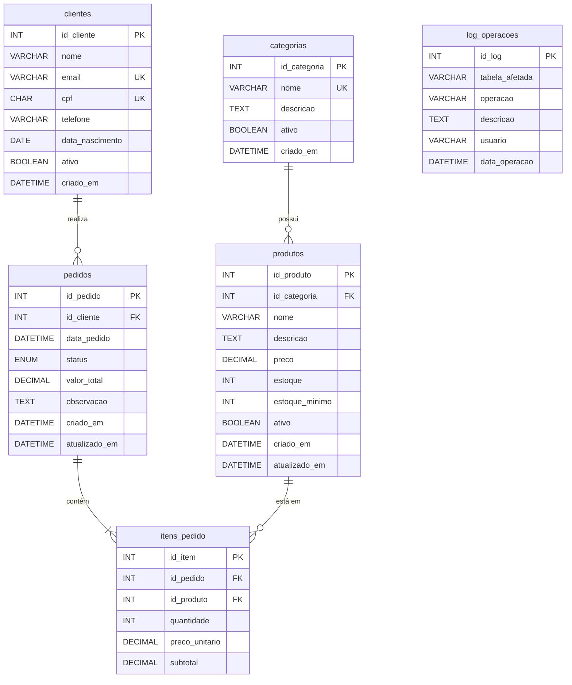

[README.md](https://github.com/user-attachments/files/35030582/README.md)
# 🛒 loja_tech: Atividades de SQL e Stored Procedures (MySQL)

Atividades práticas de banco de dados relacional usando o banco **loja_tech**, que simula o e-commerce de uma loja de produtos de tecnologia (**TechStore**). O foco é fixar a sintaxe básica de SQL, a leitura de esquema e a criação de stored procedures, em nível **muito fácil**.

## 📚 O que foi praticado

- Consultas básicas: `SELECT`, `WHERE`, `ORDER BY`, `LIKE`
- Funções de agregação: `COUNT`, `SUM` e uso de apelidos com `AS`
- Junções com `INNER JOIN`
- Filtros em grupos com `GROUP BY` e `HAVING`
- Stored procedures sem parâmetros, com `IN`, e com `IN` + `OUT`
- Boas práticas: `DROP PROCEDURE IF EXISTS`, `DELIMITER //` e prefixo `p_` nos parâmetros

## 🗂️ Modelo de dados

O banco tem 6 tabelas: `categorias`, `produtos`, `clientes`, `pedidos`, `itens_pedido` e `log_operacoes`.



### Regras de integridade

- `UNIQUE` em `email`, `cpf` e no nome da categoria
- `CHECK` para impedir preço, estoque, quantidade e valor total negativos
- `UNIQUE (id_pedido, id_produto)` para não repetir o mesmo produto no mesmo pedido
- `subtotal` é uma coluna gerada (`quantidade * preco_unitario`), então nunca fica inconsistente
- `status` do pedido: `pendente`, `processando`, `enviado`, `entregue` ou `cancelado`

## ⚙️ Como executar

**Pré-requisitos:** MySQL **8.0.16 ou superior** (necessário para os `CHECK`) e MySQL Workbench.

1. Abra o MySQL Workbench e conecte ao seu servidor.
2. Abra e execute o arquivo `loja_tech_corrigido.sql`. Ele recria o banco do zero (`DROP DATABASE IF EXISTS`), cria as tabelas e insere os dados iniciais.
3. Selecione o banco com `USE loja_tech;`.
4. Execute as consultas e as procedures das atividades.

> ⚠️ O script apaga e recria o banco `loja_tech`. Não rode em um banco com dados que você queira manter.

## 📝 Atividades

### Parte 1: 10 consultas SQL

| # | Desafio | Conceito |
|---|---------|----------|
| 1 | Nome e e-mail de todos os clientes | `SELECT` |
| 2 | Produtos abaixo de R$ 500,00 | `WHERE` |
| 3 | Pedidos com status `pendente` | `WHERE` com texto |
| 4 | Produtos do mais caro ao mais barato | `ORDER BY ... DESC` |
| 5 | Produtos com "Monitor" no nome | `LIKE '%...%'` |
| 6 | Periféricos com mais de 40 unidades em estoque | `WHERE` com `AND` |
| 7 | Total de clientes (`total_clientes`) | `COUNT` e `AS` |
| 8 | Faturamento bruto (`faturamento_bruto`) | `SUM` e `AS` |
| 9 | Produto com o nome da categoria | `INNER JOIN` |
| 10 | Pedidos da cliente Ana Silva | `INNER JOIN` com filtro |

### Parte 2: 5 stored procedures

| # | Procedure | Tipo de parâmetro |
|---|-----------|-------------------|
| 1 | `listar_categorias_ativas` | Sem parâmetros |
| 2 | `buscar_pedidos_por_status` | `IN` |
| 3 | `inserir_categoria` | `IN` (inserção) |
| 4 | `atualizar_telefone_cliente` | `IN` (atualização) |
| 5 | `contar_produtos_categoria` | `IN` e `OUT` |

### Exemplo de uso das procedures

```sql
CALL listar_categorias_ativas();
CALL buscar_pedidos_por_status('entregue');
CALL inserir_categoria('Acessórios', 'Cabos, capas e carregadores');
CALL atualizar_telefone_cliente(1, '11999990000');

CALL contar_produtos_categoria(3, @total);
SELECT @total AS total_produtos;   -- retorna 3
```

## 💡 Dicas e problemas comuns

- **Erro com `DELIMITER`:** as procedures precisam estar entre `DELIMITER //` e `DELIMITER ;`. Selecione o bloco inteiro antes de executar.
- **Procedure "não existe" (erro 1305):** o `DROP DATABASE` apaga também as procedures. Recrie-as depois de rodar o script do banco.
- **Variável `@total` voltando `NULL`:** o `CALL` e o `SELECT` precisam rodar na mesma aba e na mesma execução.
- **Ctrl+Enter** executa só o comando onde está o cursor. Para rodar um trecho, selecione-o com o mouse e clique no raio.

## 🛠️ Tecnologias

- MySQL 8
- MySQL Workbench

## 👩‍💻 Autora

**Paola Cristine**
GitHub: [@paolacristina7](https://github.com/paolacristine7)
